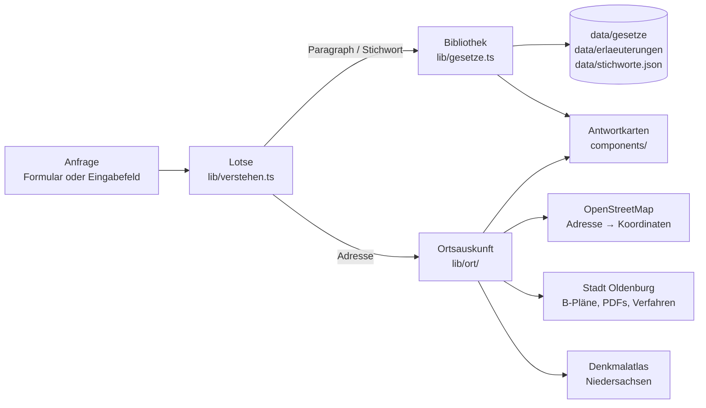

# Bau-Normen-KI – Baurecht im Wortlaut

Ein Nachschlage- und Auskunftswerkzeug für die Baubranche:

- **Gesetze im amtlichen Wortlaut** – Baugesetzbuch (BauGB) und Niedersächsisches Denkmalschutzgesetz (NDSchG), Paragraph für Paragraph, unverändert aus den amtlichen Quellen
- **verständlich erklärt** – zu jedem Paragraphen eine Erläuterung und die zusammenhängenden Vorschriften
- **Ortsauskunft für Oldenburg (Oldb)** – zu einer Adresse: gilt ein Bebauungsplan, gibt es Kulturdenkmale, welche Paragraphen sind zu beachten

> **Prototyp**, Stand 16.11.2026. Die Auskünfte ersetzen keine Rechtsberatung und keine Auskunft der Bauaufsicht oder der Denkmalschutzbehörde.

---

## Inhalt

1. [Funktionen](#funktionen)
2. [Grundsätze: Warum man der App trauen kann](#grundsätze-warum-man-der-app-trauen-kann)
3. [Schnellstart](#schnellstart)
4. [Bedienung](#bedienung)
5. [So funktioniert es](#so-funktioniert-es)
6. [Projektstruktur](#projektstruktur)
7. [Befehle](#befehle)
8. [Gesetze aktualisieren](#gesetze-aktualisieren)
9. [Qualitätssicherung](#qualitätssicherung)
10. [Obsidian-Ansicht](#obsidian-ansicht)
11. [Der Gecko](#der-gecko)
12. [Datenquellen und Rechtliches](#datenquellen-und-rechtliches)
13. [Weiterführende Dokumente](#weiterführende-dokumente)

---

## Funktionen

| Funktion | Was passiert |
|---|---|
| **Paragraph abrufen** | „§ 34 BauGB“, „§§ 30, 34 und 35 BauGB“, „35 BauGB“, „Paragraph 13a“ – der Paragraph erscheint im amtlichen Wortlaut mit Stand, Quelle und Kopier-Knopf. Gibt es eine Nummer in beiden Gesetzen („Paragraph 5“), fragt die App nach. Gibt es sie nicht („§ 300 BauGB“), sagt sie das – statt zu raten. |
| **Erläuterung** | Unter dem Wortlaut steht eine leicht verständliche, aber detaillierte Erläuterung: Kurzfassung, jeder Absatz einzeln, Hinweis für die Praxis. Vorhanden für BauGB §§ 1–38 und das komplette NDSchG (88 Paragraphen, Status „Entwurf“). |
| **Zusammenhang** | „Verweist auf“, „Wird erwähnt in“ und „Gleicher Abschnitt“ – automatisch aus den Verweisen im Gesetzestext ermittelt, jeweils anklickbar. |
| **Stichwortsuche** | „Vorkaufsrecht“, „Innenbereich“, „Bauen neben einem Denkmal“ – ein von Hand gepflegtes Stichwortverzeichnis (rund 60 Fachbegriffe) plus Volltextsuche. |
| **Ortsauskunft Oldenburg** | Adresse → Standort → **Bebauungsplan** der Stadt Oldenburg (mit Planzeichnung und Begründung als PDF, falls online verfügbar), **Pläne in Aufstellung**, **Veränderungssperren** → **Kulturdenkmale** im Umkreis von 50 m (Denkmalatlas Niedersachsen) → **Einordnung** nach festen Regeln mit den einschlägigen Paragraphen. |
| **Lageskizze** | Schematische Skizze des Standorts: Umkreis 50 m, B-Plan-Grenze, Denkmalflächen – ein kleiner Gecko krabbelt darüber und markiert die Denkmale mit Fähnchen. |
| **Obsidian-Ansicht** | Alle Paragraphen, die Gliederung und die Dateien der App als vernetzte Notizen für [Obsidian](https://obsidian.md) – mit Graph-Ansicht. |
| **Gecko** | Ein kleines Maskottchen, das auf der Seite unterwegs ist und bei Fehlern oder Hinweisen die Farbe wechselt. |

---

## Grundsätze: Warum man der App trauen kann

1. **Der Gesetzestext wird nie von einer KI geschrieben.** Er wird einmal aus der amtlichen Quelle importiert und unverändert angezeigt. Ein Prüfprogramm vergleicht jeden gespeicherten BauGB-Paragraphen Zeichen für Zeichen mit der amtlichen Einzelseite (zuletzt: 297 von 297 identisch).
2. **Die App braucht zur Laufzeit keine KI.** Paragraphen, Stichworte und Ortsauskunft funktionieren nach festen, nachvollziehbaren Regeln. Es wird kein API-Schlüssel benötigt.
3. **Erläuterungen sind fest gespeichert** – sie wurden während der Entwicklung geschrieben, gegen den Gesetzestext geprüft und als Datei abgelegt. Jede/r sieht denselben Text; bis zur fachlichen Prüfung tragen sie den Status „Entwurf“.
4. **Kein Raten bei Ausfällen.** Antwortet ein Datendienst nicht, steht dort „keine Aussage möglich“ – niemals „kein B-Plan“ oder „kein Denkmal“.
5. **Quelle und Stand stehen immer dabei.**
6. **Hinweis Denkmalschutz:** In Niedersachsen ist ein Kulturdenkmal auch ohne Eintrag im Verzeichnis geschützt (§ 5 Abs. 1 NDSchG). Kein Treffer im Denkmalatlas heißt also nicht automatisch „kein Denkmal“ – die App weist jedes Mal darauf hin.

---

## Schnellstart

Voraussetzung: [Node.js](https://nodejs.org) 20 oder neuer.

```bash
npm install
npm run dev
```

Dann im Browser **http://localhost:3000** öffnen.

Die Gesetze und Erläuterungen liegen bereits im Repository (`data/`) – ein Import ist für den Start nicht nötig. Für die Ortsauskunft braucht der Rechner eine Internetverbindung.

---

## Bedienung

Die Seite hat links drei feste Formulare und rechts den Auskunftsbereich mit Eingabefeld.

| Bereich | Verwendung |
|---|---|
| **A · Ortsauskunft Oldenburg** | Straße und Hausnummer eintragen → „Standort prüfen“ |
| **B · Paragraph abrufen** | Gesetz wählen, Nummer eintragen (z. B. `34` oder `13a`) → „Wortlaut anzeigen“ |
| **C · Bibliothek** | Welche Gesetze in welchem Stand enthalten sind, mit Link zur amtlichen Quelle |
| **Eingabefeld unten** | Freie Eingabe: Paragraph, Stichwort oder Adresse, z. B. „Ich brauche § 35 BauGB“, „Vorkaufsrecht“, „Gartenstraße 5“ |

In jeder Paragraph-Karte: **kopieren** (Wortlaut mit Quelle in die Zwischenablage), **Quelle ↗** (amtliche Einzelseite), **Obsidian → Notiz öffnen**, Paragraphen-Chips zum Weiterklicken.

---

## So funktioniert es



- **Lotse** (`lib/verstehen.ts`): erkennt nach festen Mustern, ob nach einem Paragraphen, einem Stichwort oder einer Adresse gefragt wird.
- **Bibliothek** (`lib/gesetze.ts`): liefert Wortlaut, Erläuterung und Zusammenhänge aus `data/` – hier wird kein Text erzeugt.
- **Ortsauskunft** (`lib/ort/`): fragt die Datendienste ab und leitet nach festen Regeln ab, welche Paragraphen gelten (z. B. kein B-Plan → § 34 oder § 35 BauGB; Denkmal am Standort → § 10 NDSchG).
- **Oberfläche** (`components/`): zeigt die Antworten als Karten im „Schriftfeld“-Stil.

---

## Projektstruktur

| Pfad | Inhalt |
|---|---|
| `app/` | Seite (`page.tsx`), Grundgerüst (`layout.tsx`), Gestaltung (`globals.css`) und die Schnittstelle `api/frage/route.ts`, die alle Anfragen beantwortet |
| `components/` | Oberfläche: `ChatApp.tsx` (Seite mit Formularen und Verlauf), `Karten.tsx` (Paragraph- und Ortsauskunft-Karte), `Normtext.tsx` (Wortlaut), `Lageskizze.tsx`, `Obsidian.tsx` (Knopf und Links), `Gecko.tsx` + `GeckoFigur.tsx`, `Symbole.tsx` |
| `lib/` | Logik: `verstehen.ts` (Lotse), `gesetze.ts` (Bibliothek, Suche), `ort/` (Ortsauskunft: Standort, B-Plan, Plan-Dokumente, Denkmale, Geometrie), `gecko.ts` (Regeln für den Gecko), `typen.ts`, `text.ts` |
| `data/gesetze/` | Die Gesetze als JSON – Paragraph für Paragraph mit Struktur, Wortlaut und erkannten Verweisen |
| `data/erlaeuterungen/` | Erläuterungen je Gesetz, dazu `LEITFADEN.md` (Regeln zum Schreiben) und `PRUEFHINWEISE.md` (Stellen für die fachliche Prüfung) |
| `data/stichworte.json` | Stichwortverzeichnis (Begriff → Paragraphen) |
| `data/quellen/` | Amtliche Rohdaten (BauGB-XML); NI-VORIS-Rohdaten werden bewusst nicht versioniert |
| `scripts/` | Import der Gesetze, Prüfprogramme, Obsidian-Export |
| `tests/testkatalog.mjs` | Testfragen mit erwarteten Antworten |
| `obsidian/` | Erzeugter Obsidian-Vault (Gesetze, Gliederung, Projektdateien) |
| `TODO.md` | Plan, erledigte Punkte, nächste Schritte |

---

## Befehle

| Befehl | Zweck |
|---|---|
| `npm run dev` | App lokal starten (http://localhost:3000) |
| `npm run build` / `npm start` | Produktionsversion bauen bzw. starten |
| `npm run import:all` | BauGB und NDSchG neu aus den amtlichen Quellen laden (`import:baugb`, `import:ndschg` einzeln) |
| `node scripts/wortlaut-pruefen.mjs` | Jeden BauGB-Paragraphen mit der amtlichen Einzelseite vergleichen (ca. 2 Minuten; einzelne: `… 34 35`) |
| `node scripts/erlaeuterungen-pruefen.mjs` | Erläuterungen prüfen (Pflichtfelder, nur Paragraphen/Absätze, die es im Original gibt) |
| `npm run obsidian` | Obsidian-Vault neu erzeugen – mit Selbsttest, dass der Wortlaut unverändert ist |
| `node tests/testkatalog.mjs` | Testkatalog gegen die laufende App (`npm run dev` muss laufen; fragt teils echte Dienste ab) |

---

## Gesetze aktualisieren

Wenn sich ein Gesetz ändert (das NDSchG etwa wird derzeit im Landtag novelliert):

```bash
npm run import:all                          # 1. neue Fassung laden
node scripts/wortlaut-pruefen.mjs           # 2. Wortlaut gegen die amtlichen Seiten prüfen
node scripts/erlaeuterungen-pruefen.mjs     # 3. passen die Erläuterungen noch?
npm run obsidian                            # 4. Obsidian-Vault aktualisieren
node tests/testkatalog.mjs                  # 5. Testkatalog (App muss laufen)
```

Geänderte Paragraphen sollten danach auch inhaltlich mit ihrer Erläuterung abgeglichen werden.

---

## Qualitätssicherung

| Prüfung | Ergebnis (16.11.2026) |
|---|---|
| Wortlaut BauGB gegen gesetze-im-internet.de | 297/297 Paragraphen identisch |
| Wortlaut NDSchG gegen NI-VORIS (beim Import) | Stichproben Zeichen für Zeichen identisch |
| Erläuterungen (automatische Prüfung) | 88 Erläuterungen, 0 Fehler, 0 Warnungen |
| Obsidian-Export (Wortlaut-Selbsttest) | 339/339 Vorschriften identisch |
| Testkatalog | 29/29 Fragen – Paragraphen, Rückfragen, Stichworte, Ortsauskunft (live) |

---

## Obsidian-Ansicht

Der Ordner `obsidian/` ist ein [Obsidian](https://obsidian.md)-Vault:

- je Paragraph eine Notiz mit Wortlaut, Erläuterung, Verweisen und Quelle
- die Gliederung (Kapitel → Teil → Abschnitt) als Baum
- jede Datei der App mit Kurzbeschreibung und Verbindungen zu anderen Dateien
- Farben im Graph: BauGB grün · NDSchG ocker · Gliederung grau-blau · Projektdateien grau

**Öffnen:** einmalig in Obsidian „Ordner als Vault öffnen“ → Ordner `obsidian` wählen. Danach öffnet der Knopf **„Obsidian-Ansicht“** oben rechts in der App den Vault direkt, und jede Paragraph-Karte hat einen Link „Notiz öffnen“. Graph-Ansicht: `Strg + G`.

Nach Änderungen an Gesetzen oder Code: `npm run obsidian`.

---

## Der Gecko

Ein kleines, bewusst zurückhaltendes Maskottchen:

- läuft quer über den Bildschirm von Kasten zu Kasten und bleibt am **rechten Rand** der Kästen stehen
- setzt sich an neue Antworten; im Stehen ist er ruhig, rollt die Schwanzspitze ein und schaut sich ab und zu um
- **Maus darüber:** er rollt sich ein
- **Farbe:** grün = alles in Ordnung · **orange** = Hinweis (z. B. Hausnummer nicht gefunden, kein Stichwort erkannt) · **rot** = Fehler (z. B. Paragraph existiert nicht, Dienst nicht erreichbar) – beim Darüberfahren zeigt er die Meldungen
- er blockiert keine Klicks, kann in der Seitenleiste ausgeblendet werden und bleibt bei „reduzierter Bewegung“ (Systemeinstellung) still

Gezeichnet wird er als bewegliches Skelett (Kopf, Rumpf, Schwanzglieder, vier Beine); der Gang folgt dem echten Vorbild: diagonale Beinpaare im Wechsel, der Rumpf knickt im Takt abwechselnd zur Seite ein.

---

## Datenquellen und Rechtliches

| Daten | Quelle |
|---|---|
| BauGB | Bundesministerium der Justiz / juris – [gesetze-im-internet.de](https://www.gesetze-im-internet.de/bbaug/) (XML) |
| NDSchG | Niedersächsisches Vorschrifteninformationssystem (NI-VORIS) |
| Bebauungspläne | Stadt Oldenburg – Open Data „Umringe rechtsverbindlicher Bebauungspläne“ und Kartenportal „Bauen & Wohnen“ (Plan-Dokumente, Pläne in Aufstellung, Veränderungssperren) |
| Kulturdenkmale | [Denkmalatlas Niedersachsen](https://denkmalatlas.niedersachsen.de) – Niedersächsisches Landesamt für Denkmalpflege |
| Adresssuche | OpenStreetMap / Nominatim |

- Amtliche Gesetzestexte sind gemeinfrei (§ 5 UrhG).
- NI-VORIS behält sich automatisiertes Text- und Data-Mining vor. Gespeichert und veröffentlicht wird deshalb nur der gemeinfreie Gesetzestext, nicht die Roh-HTML-Seiten des Anbieters. Für eine kommerzielle Nutzung ist das erneut zu prüfen.
- DIN-Normen sind – anders als Gesetze – urheberrechtlich geschützt; vor einer Aufnahme ist die Lizenzfrage zu klären (siehe `TODO.md`).
- Die Erläuterungen sind Orientierungshilfen (Status „Entwurf“) und keine Rechtsberatung. Maßgeblich ist der amtliche Wortlaut.

---

## Weiterführende Dokumente

- [TODO.md](TODO.md) – Plan, erledigte Punkte, nächste Schritte (u. a. Erläuterungen für BauGB §§ 39–250, weitere Landes-Denkmalschutzgesetze, Normen)
- [data/erlaeuterungen/LEITFADEN.md](data/erlaeuterungen/LEITFADEN.md) – Regeln für das Schreiben von Erläuterungen
- [data/erlaeuterungen/PRUEFHINWEISE.md](data/erlaeuterungen/PRUEFHINWEISE.md) – Stellen, die eine Fachperson prüfen sollte
- [obsidian/Projekt/Architektur.md](obsidian/Projekt/Architektur.md) – Zusammenspiel der Bausteine
