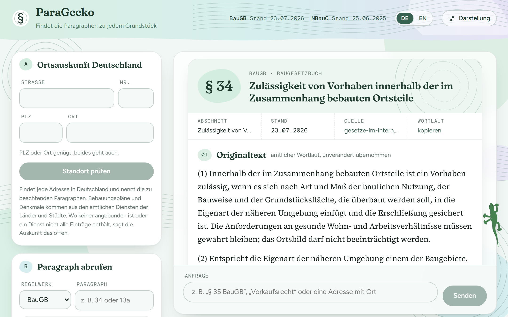
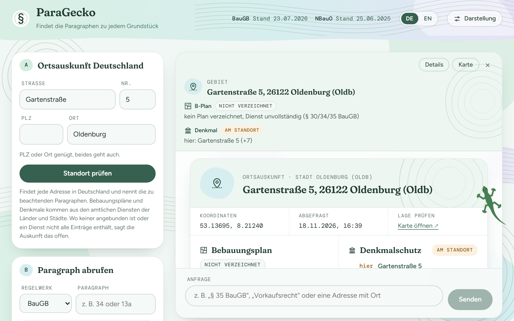
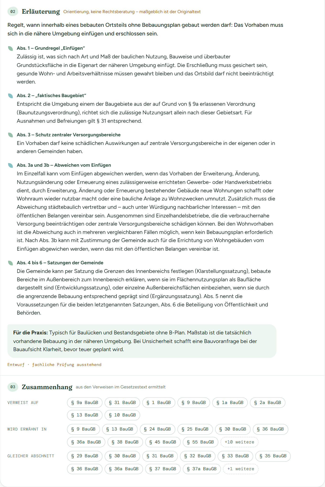
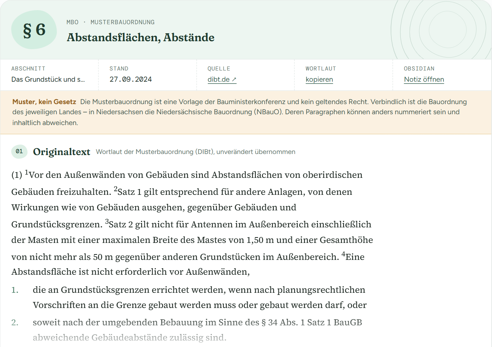
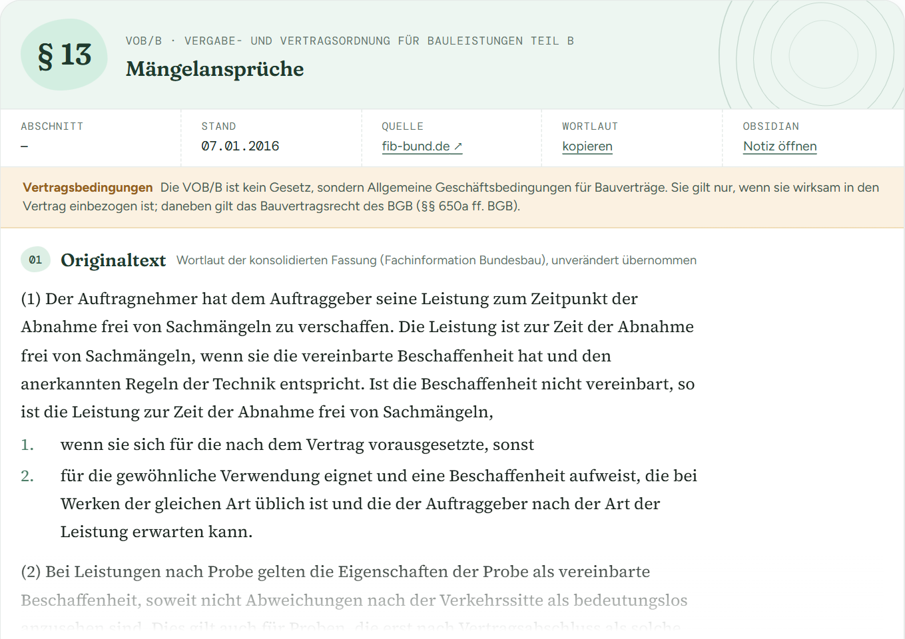
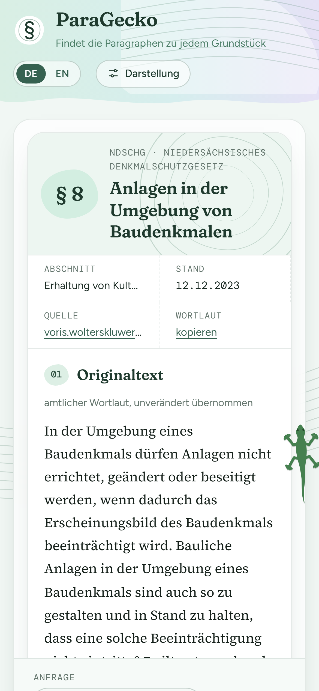
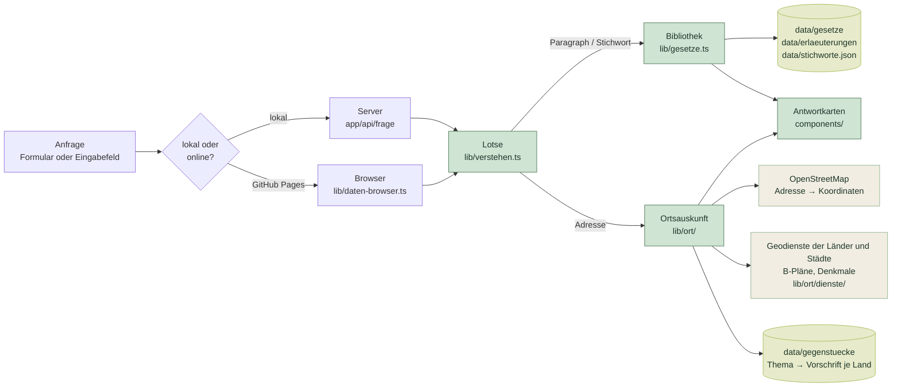
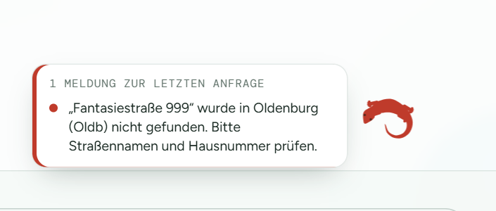

<p align="center">
  
</p>

<p align="center">
  <a href="https://jade-hs-vibecoding-wpk.github.io/ParaGecko/"><b>▶ Online ausprobieren</b></a>
  &nbsp;·&nbsp; <a href="#schnellstart">Lokal starten</a>
  &nbsp;·&nbsp; <a href="#so-funktioniert-es">So funktioniert es</a>
  &nbsp;·&nbsp; <a href="TODO.md">Plan &amp; nächste Schritte</a>
</p>

<p align="center">
  
  
  
  
  
</p>

# ParaGecko

**Findet die Paragraphen zu jedem Grundstück.**

Ein Nachschlage- und Auskunftswerkzeug für die Baubranche (bis 18.11.2026 unter dem Arbeitstitel „Bau-Normen-KI“):

- **Gesetze und Regelwerke im Wortlaut:** Baugesetzbuch (BauGB), Bauordnung und Denkmalschutzgesetz von sechs Ländern (Niedersachsen, Bayern, Nordrhein-Westfalen, Sachsen, Brandenburg, Bremen), die Bauordnungen von Baden-Württemberg, Hessen und Hamburg, Musterbauordnung (MBO), VOB Teil A und Teil B, Paragraph für Paragraph, unverändert aus den amtlichen Quellen; dazu das Verzeichnis der VOB Teil C (ATV)
- **verständlich erklärt:** Erläuterungen in einfacher Sprache für BauGB §§ 1 bis 38, NBauO, NDSchG, Musterbauordnung und VOB/B (301 Vorschriften), dazu bei jedem Paragraphen die zusammenhängenden Vorschriften
- **Ortsauskunft für Adressen in ganz Deutschland:** Gilt ein Bebauungsplan, gibt es Kulturdenkmale, welche Paragraphen des Bundes und des Landes sind zu beachten? Dafür werden 44 Bebauungsplan- und 23 Denkmaldienste der Länder und Städte live abgefragt. Wo kein Dienst angebunden ist oder ein Dienst nicht alle Einträge enthält, sagt die App das offen

> Forschungsprojekt, Stand 18.11.2026. **Nutzung nur privat und nicht gewerblich**, kein Open-Source-Projekt (siehe [Nutzung und Lizenz](#nutzung-und-lizenz)). Die Auskünfte ersetzen keine Rechtsberatung und keine Auskunft der Bauaufsicht oder der Denkmalschutzbehörde.

<p align="center">
  
</p>

---

## Inhalt

1. [Funktionen](#funktionen)
2. [Einblick](#einblick)
3. [Grundsätze: Warum man der App trauen kann](#grundsätze-warum-man-der-app-trauen-kann)
4. [Schnellstart](#schnellstart)
5. [Online-Version (GitHub Pages)](#online-version-github-pages)
6. [Bedienung](#bedienung)
7. [So funktioniert es](#so-funktioniert-es)
8. [Projektstruktur](#projektstruktur)
9. [Befehle](#befehle)
10. [Gesetze aktualisieren](#gesetze-aktualisieren)
11. [Qualitätssicherung](#qualitätssicherung)
12. [Gestaltung](#gestaltung)
13. [Obsidian-Ansicht](#obsidian-ansicht)
14. [Der Gecko](#der-gecko)
15. [Datenquellen und Rechtliches](#datenquellen-und-rechtliches)
16. [Nutzung und Lizenz](#nutzung-und-lizenz)
17. [Weiterführende Dokumente](#weiterführende-dokumente)

---

## Funktionen

| Funktion | Was passiert |
|---|---|
| **Paragraph abrufen** | „§ 34 BauGB“, „§§ 30, 34 und 35 BauGB“, „35 BauGB“, „Paragraph 13a“, „§ 6 MBO“, „§ 3a EU VOB/A“, „§ 13 VOB/B“, „DIN 18353“: Die Vorschrift erscheint im Wortlaut mit Stand, Quelle und Kopier-Knopf. Gibt es eine Nummer in mehreren Regelwerken („Paragraph 5“, „§ 4 VOB“), fragt die App nach. Gibt es sie nicht („§ 300 BauGB“), sagt sie das, statt zu raten. |
| **Musterbauordnung und VOB** | Die **MBO** (Muster der Bauministerkonferenz, Stand 26./27.09.2024), die **VOB/A** (Abschnitt 1 sowie die Abschnitte 2 „EU“ und 3 „VS“ in der Ausgabe 2026) und die **VOB/B** (Ausgabe 2016) im Wortlaut. Von der **VOB/C** gibt es nur das Verzeichnis der 68 ATV mit Nummer und Titel; ihr Text ist als DIN-Norm geschützt. Weil keines davon ein Gesetz ist, sagt jede Karte oben, wie verbindlich es ist (z. B. „Muster, kein geltendes Recht“ mit dem Hinweis, dass in Niedersachsen die NBauO gilt). |
| **Landesrecht** | Bauordnung und Denkmalschutzgesetz von **Niedersachsen** (NBauO, NDSchG), **Bayern** (BayBO, BayDSchG), **Nordrhein-Westfalen** (BauO NRW, DSchG NRW), **Sachsen** (SächsBO, SächsDSchG), **Brandenburg** (BbgBO, BbgDSchG) und **Bremen** (BremLBO, BremDSchG) im Wortlaut, dazu die Bauordnungen von **Baden-Württemberg** (LBO BW, aus dem Gesetzblatt), **Hessen** (HBO) und **Hamburg** (HBauO). Die beiden letzten stammen aus nichtamtlichen Lesefassungen der Ministerien, worauf jede Karte hinweist. In der Bibliothek wählt man das **Bundesland**; „§ 6 Bauordnung“ oder „§ 10 Denkmalschutzgesetz“ meint dann das Gesetz dieses Landes (Bayern zitiert mit „Art.“), Rückfragen und Stichworte beschränken sich auf Bund, Land, MBO und VOB. Nach einer Ortsauskunft wechselt die App auf das Land der Adresse. Fehlt das Gesetz eines Landes, sagt die App das, statt auf ein anderes Land auszuweichen. |
| **Erläuterung** | Unter dem Wortlaut steht eine leicht verständliche, aber detaillierte Erläuterung: Kurzfassung, jeder Absatz einzeln, Hinweis für die Praxis. Vorhanden für BauGB §§ 1 bis 38 sowie komplett für NBauO, NDSchG, Musterbauordnung und VOB/B (301 Vorschriften, Status „Entwurf“). |
| **Zusammenhang** | „Verweist auf“, „Wird erwähnt in“ und „Gleicher Abschnitt“: automatisch aus den Verweisen im Gesetzestext ermittelt, jeweils anklickbar. |
| **Stichwortsuche** | „Vorkaufsrecht“, „Innenbereich“, „Bauen neben einem Denkmal“, „Abstandsflächen“, „Abnahme“, „Estricharbeiten“: ein von Hand gepflegtes Stichwortverzeichnis (rund 120 Begriffsgruppen) plus Volltextsuche. |
| **Ortsauskunft Deutschland** | Adresse mit Postleitzahl oder Ort (eins von beiden ist Pflicht, die App sucht nicht auf gut Glück) → Standort in ganz Deutschland; passt ein Ortsname ohne Postleitzahl auf mehrere Orte (etwa „Neustadt“), fragt die App nach → alle passenden **Bebauungsplan-** und **Denkmaldienste** des Landes und der Stadt werden gleichzeitig abgefragt und zusammengeführt ([Tabelle](#geodienste-der-länder-und-städte)) → **Kulturdenkmale** im Umkreis von 50 m → **Einordnung** nach festen Regeln: BauGB, dazu Bauordnung und Denkmalschutzgesetz **des Landes, in dem die Adresse liegt**, mit den einschlägigen Vorschriften. In Oldenburg zusätzlich Planzeichnung und Begründung als PDF, Pläne in Aufstellung und Veränderungssperren. „Kein Plan“ steht nur da, wo ein Dienst nachweislich alle Pläne enthält (Hamburg, Bremerhaven); sonst heißt es „nicht verzeichnet“, mit einem Hinweis zur Abdeckung des Dienstes. Wo kein Dienst angebunden ist, steht „keine Aussage“ mit den bundesweit geltenden Regeln (§§ 30, 34, 35 BauGB). |
| **Gebietsleiste** | Die Hauptinformationen zum zuletzt geprüften Gebiet (Adresse, Bebauungsplan mit Link zur Planzeichnung, Denkmalschutz) stehen fest über dem Verlauf. Sie bewegen sich nur mit der Seite; die Details darunter scrollen wie im Chat. |
| **Lageskizze** | Skizze des Standorts auf einer **OpenStreetMap-Karte**: Umkreis 50 m, B-Plan-Grenze, Denkmalflächen. Die Karte lässt sich **zoomen** (Mausrad, +/−, Doppelklick, zwei Finger) und **verschieben** (Ziehen, Pfeiltasten). Der Gecko der Seite läuft hin und steckt an Standort und Denkmalen die Fähnchen. |
| **Obsidian-Ansicht** | Alle Paragraphen, die Gliederung und die Dateien der App als vernetzte Notizen für [Obsidian](https://obsidian.md), mit Graph-Ansicht. |
| **Gecko** | Ein kleines Maskottchen, das auf der Seite unterwegs ist und bei Fehlern oder Hinweisen die Farbe wechselt. Über Text wird er durchsichtig; auf Wunsch sitzt er still und dient nur als Signal. |
| **Hell & Dunkel** | Helles und dunkles Farbschema, oder automatisch wie im Betriebssystem eingestellt (Menü **Darstellung**). |
| **Deutsch & Englisch** | Die gesamte Oberfläche, die Ortsauskunft und alle Hinweise gibt es auf Deutsch und Englisch (Umschalter **DE/EN**). Der Text der Vorschriften bleibt im deutschen Wortlaut. |
| **Online-Version** | Die App läuft auch ohne Server direkt im Browser, veröffentlicht auf [GitHub Pages](https://jade-hs-vibecoding-wpk.github.io/ParaGecko/). |

---

## Einblick

<table>
  <tr>
    <td width="50%" valign="top">
      
      <p align="center"><b>Paragraph abrufen</b><br><sub>„§ 34 BauGB“: Wortlaut mit Stand, Quelle und Kopier-Knopf</sub></p>
    </td>
    <td width="50%" valign="top">
      
      <p align="center"><b>Ortsauskunft</b><br><sub>„Gartenstraße 5, Oldenburg“: Bebauungsplan und Kulturdenkmale, live abgefragt</sub></p>
    </td>
  </tr>
  <tr>
    <td width="50%" valign="top">
      
      <p align="center"><b>Erläuterung &amp; Zusammenhang</b><br><sub>jeder Absatz einzeln erklärt, verwandte Paragraphen zum Weiterklicken</sub></p>
    </td>
    <td width="50%" valign="top">
      
      <p align="center"><b>Lageskizze</b><br><sub>auf OpenStreetMap; der Gecko läuft hin und steckt die Fähnchen</sub></p>
    </td>
  </tr>
</table>

<p align="center">
  
  <br><sub><b>Dunkel &amp; Englisch:</b> Ortsauskunft „Damm 30“ mit angehefteter Gebietsleiste; umschaltbar über <b>DE/EN</b> und <b>Darstellung</b></sub>
</p>

<table>
  <tr>
    <td width="50%" valign="top"><br><sub><b>Musterbauordnung:</b> mit hochgestellten Satznummern und dem Hinweis, dass in Niedersachsen die NBauO gilt</sub></td>
    <td width="50%" valign="top"><br><sub><b>VOB/B:</b> Jede Karte sagt, wie verbindlich das Regelwerk ist</sub></td>
  </tr>
</table>

<table>
  <tr>
    <td width="33%" valign="top"></td>
    <td width="33%" valign="top"></td>
    <td width="34%" valign="middle">
      <b>Auch unterwegs</b><br>
      Auf dem Smartphone stehen Auskunft und Eingabe oben, die Formulare darunter. Gesetzestext und Erläuterung bleiben gut lesbar, etwa beim Ortstermin oder auf der Baustelle.
    </td>
  </tr>
</table>

---

## Grundsätze: Warum man der App trauen kann

1. **Der Gesetzestext wird nie von einer KI geschrieben.** Er wird einmal aus der amtlichen Quelle importiert und unverändert angezeigt. Ein Prüfprogramm vergleicht jeden gespeicherten BauGB-Paragraphen Zeichen für Zeichen mit der amtlichen Einzelseite (zuletzt: 297 von 297 identisch).
2. **Die App braucht zur Laufzeit keine KI.** Paragraphen, Stichworte und Ortsauskunft funktionieren nach festen, nachvollziehbaren Regeln. Es wird kein API-Schlüssel benötigt.
3. **Erläuterungen sind fest gespeichert.** Sie wurden während der Entwicklung geschrieben, gegen den Gesetzestext geprüft und als Datei abgelegt. Jede/r sieht denselben Text; bis zur fachlichen Prüfung tragen sie den Status „Entwurf“.
4. **Kein Raten bei Ausfällen.** Antwortet ein Datendienst nicht, steht dort „keine Aussage möglich“, niemals „kein B-Plan“ oder „kein Denkmal“.
5. **Quelle und Stand stehen immer dabei.**
6. **Hinweis Denkmalschutz:** Ob ein Kulturdenkmal auch ohne Eintrag in die Denkmalliste geschützt ist, regelt jedes Land selbst: in Niedersachsen ja (§ 5 Abs. 1 NDSchG), in Nordrhein-Westfalen grundsätzlich erst mit der Eintragung (§ 5 DSchG NRW). Die App nennt es je Land mit dem wörtlichen Satz aus dem Gesetz. Kein Denkmaldienst gilt als vollständig; kein Treffer heißt deshalb nie „kein Denkmal“, sondern „nicht verzeichnet“.
7. **Nur, was frei verwendet werden darf:** Gesetze, Musterbauordnung und die im Bundesanzeiger bekannt gemachte VOB/A und VOB/B stehen im Wortlaut in der App. Die ATV der VOB/C sind DIN-Normen und urheberrechtlich geschützt (§ 5 Abs. 3 UrhG). Die App nennt nur Nummer und Titel und verweist auf DIN Media.
8. **Englisch ohne Übersetzungsdienst:** Alle englischen Texte stehen im Code direkt neben dem deutschen Original (`t("…", "…")`). Gesetzestext und Erläuterungen werden nicht übersetzt. Verbindlich ist allein der deutsche Wortlaut, und die App sagt das auch auf Englisch.
9. **Landesrecht nur aus dem richtigen Land:** Für eine Adresse in Bayern nennt die App BayBO und BayDSchG, nie die Vorschriften eines anderen Landes. Welche Vorschrift welches Thema regelt (Genehmigungspflicht, Abstandsflächen, Umgebungsschutz …), steht von Hand am Wortlaut geprüft in `data/gegenstuecke/`; ein Prüfprogramm stellt sicher, dass jede genannte Vorschrift existiert und jedes Zitat wörtlich im Gesetz steht. Fehlt das Gesetz eines Landes, nennt die App keine Paragraphen daraus.

---

## Schnellstart

Voraussetzung: [Node.js](https://nodejs.org) 20 oder neuer.

```bash
npm install
npm run dev
```

Dann im Browser **http://localhost:3000** öffnen.

Die Gesetze und Erläuterungen liegen bereits im Repository (`data/`). Ein Import ist für den Start nicht nötig. Für die Ortsauskunft braucht der Rechner eine Internetverbindung.

Ohne Installation geht es auch: **[Online-Version auf GitHub Pages](https://jade-hs-vibecoding-wpk.github.io/ParaGecko/)**.

---

## Online-Version (GitHub Pages)

**Adresse:** https://jade-hs-vibecoding-wpk.github.io/ParaGecko/

GitHub Pages liefert nur fertige Dateien aus; einen Server gibt es dort nicht. Die App ist deshalb so gebaut, dass **derselbe Code** in zwei Betriebsarten läuft:

| | Lokal (`npm run dev`) | Online (GitHub Pages) |
|---|---|---|
| Wer beantwortet die Anfrage? | Next.js-Server, Schnittstelle `/api/frage` | der Browser selbst |
| Woher kommen Gesetze und Erläuterungen? | `data/` vom Dateisystem (`lib/daten-server.ts`) | `/daten/`, in Stufen geladen (`lib/daten-browser.ts`, siehe unten) |
| Ortsauskunft | Server fragt OpenStreetMap und die Geodienste der Länder und Städte ab | Browser fragt dieselben Dienste direkt ab (alle erlauben das) |
| Obsidian-Knopf | ja | nein, der Vault liegt nur auf dem eigenen Rechner |

Lotse, Bibliothek und Ortsauskunft (`lib/`) sind in beiden Fällen identisch; es gibt keine zweite, abweichende Fassung der Regeln.

**Schnell, auch mit vielen Regelwerken:** Die Online-Version lädt nicht mehr alle Gesetzestexte auf einmal (zuletzt 3,4 MB), sondern in Stufen:

| Datei | Größe (gepackt) | Wann geladen |
|---|---|---|
| `daten/index.json`: alle Regelwerke mit Titel, Gliederung, Verweisen | ca. 26 KB | gleich nach dem Seitenaufbau im Leerlauf |
| `daten/wortlaut/<gesetz>/<id>.json`: Wortlaut einer Vorschrift | wenige KB | wenn die Vorschrift angezeigt wird |
| `daten/erlaeuterungen/<gesetz>.json` | 20 bis 40 KB | bei der ersten Vorschrift dieses Gesetzes |
| `daten/suche.json`: Suchtexte | ca. 320 KB | erst bei einer Freitextsuche |

Auf dem Server werden Verweise, Abschnitte und Suchtexte einmal je Datenstand vorbereitet statt bei jeder Anfrage; ob sich Daten geändert haben, prüft er höchstens alle 2 Sekunden. Neue Regelwerke machen die Seite dadurch kaum langsamer.

**Veröffentlichen:** Bei jedem Push auf `main` baut der Workflow [`.github/workflows/pages.yml`](.github/workflows/pages.yml) die Seite neu und veröffentlicht sie. Einmalig muss im Repository unter **Settings → Pages → Source** „**GitHub Actions**“ ausgewählt sein.

**Lokal ausprobieren:**

```bash
npm run build:pages      # baut die Online-Version nach out/
npm run preview:pages    # zeigt sie unter http://localhost:3100/ParaGecko/
```

---

## Bedienung

Die Seite hat links drei feste Formulare und rechts den Auskunftsbereich mit Eingabefeld. Oben rechts stehen die Sprachwahl **DE/EN** und das Menü **Darstellung**.

| Bereich | Verwendung |
|---|---|
| **A · Ortsauskunft Deutschland** | Straße und Hausnummer eintragen, dazu Postleitzahl oder Ort (eins genügt, ohne beides bleibt der Knopf aus) → „Standort prüfen“ |
| **B · Paragraph abrufen** | Regelwerk wählen, Nummer eintragen (z. B. `34`, `13a`, bei der VOB/A auch `3a EU`; bei der VOB/C die DIN-Nummer, z. B. `18353`) → „Wortlaut anzeigen“ |
| **C · Bibliothek** | Bundesland wählen; aufgeklappt zeigt die Liste die Regelwerke für dieses Land (Bundesrecht, Landesrecht, Muster, VOB) mit Stand und Link zur Quelle. Dieselbe Auswahl gilt für „B · Paragraph abrufen“ |
| **Eingabefeld unten** | Freie Eingabe: Paragraph, Stichwort oder Adresse, z. B. „Ich brauche § 35 BauGB“, „section 35 BauGB“, „§ 13 VOB/B“, „DIN 18353“, „Vorkaufsrecht“, „Gartenstraße 5, Oldenburg“. Adressen erkennt die App an der Straßenendung (…straße, …weg, …platz) oder an einer Postleitzahl hinter der Hausnummer („Zeil 1, 60313 Frankfurt“), auch mitten im Satz. Fehlen Ort und Postleitzahl, bittet die App darum, sie zu ergänzen |
| **Gebietsleiste** | Erscheint nach einer Ortsauskunft fest über dem Verlauf: Adresse, B-Plan, Denkmalschutz; „Details“ und „Karte“ springen zur Auskunft, „ד blendet sie aus |
| **DE / EN** | Sprache der Oberfläche und der Antworten (neue Anfragen werden in der gewählten Sprache beantwortet) |
| **Darstellung** | Farbschema Hell / Dunkel / Auto · Gecko „Läuft“ oder „Sitzt still“ · Animationen an/aus; die Auswahl wird im Browser gemerkt |

In jeder Paragraph-Karte: **kopieren** (Wortlaut mit Quelle in die Zwischenablage), **Quelle ↗** (amtliche Einzelseite), **Obsidian → Notiz öffnen** (nur lokal), Paragraphen-Chips zum Weiterklicken.

Karte der Lageskizze: **Mausrad** oder **+/−** zoomt, **Ziehen** verschiebt, **Doppelklick** zoomt hinein, der Knopf mit dem Fadenkreuz setzt zurück. Auf dem Smartphone mit zwei Fingern; per Tastatur nach einem Klick in die Karte mit den Pfeiltasten, `+`, `−` und `0`.

---

## So funktioniert es



- **Lotse** (`lib/verstehen.ts`): erkennt nach festen Mustern, ob nach einem Paragraphen, einem Stichwort oder einer Adresse gefragt wird.
- **Bibliothek** (`lib/gesetze.ts`): liefert Wortlaut, Erläuterung und Zusammenhänge aus `data/`; hier wird kein Text erzeugt.
- **Ortsauskunft** (`lib/ort/`): fragt alle passenden Dienste gleichzeitig ab (`lib/ort/dienste/`, je Land eine Datei; jeder Dienst sagt, ob er vollständig ist und was er abdeckt), führt die Antworten zusammen und leitet nach festen Regeln ab, welche Paragraphen gelten (z. B. kein B-Plan → § 34 oder § 35 BauGB; Denkmal am Standort → Genehmigungspflicht nach dem Denkmalschutzgesetz des Landes, etwa § 10 NDSchG oder Art. 6 BayDSchG).
- **Länder** (`lib/laender.ts`, `data/gegenstuecke/`): die 16 Länder mit Bauordnung und Denkmalschutzgesetz; je Landesgesetz, welche Vorschrift welches Thema regelt. Daraus entstehen die Einordnung der Ortsauskunft und die Stichworte mit Platzhaltern wie `@bauordnung:abstandsflaechen`.
- **Oberfläche** (`components/`): zeigt die Antworten als Karten, mit Kopfteil (Paragraph, Titel, Stand, Quelle) und den Abschnitten Originaltext, Erläuterung, Zusammenhang.
- **Datenquelle** (`lib/daten-server.ts` bzw. `lib/daten-browser.ts`): regelt nur, *woher* die Dateien kommen: Dateisystem oder Browser.

---

## Projektstruktur

| Pfad | Inhalt |
|---|---|
| `app/` | Seite (`page.tsx`), Grundgerüst und Schriften (`layout.tsx`), Gestaltung (`globals.css`) und die Schnittstelle `api/frage/route.ts` für die lokale Fassung |
| `components/` | Oberfläche: `ChatApp.tsx` (Seite mit Formularen und Verlauf), `Karten.tsx` (Paragraph- und Ortsauskunft-Karte), `Normtext.tsx` (Wortlaut), `Lageskizze.tsx` (Karte und Fähnchen), `Obsidian.tsx` (Knopf und Links), `Gecko.tsx`, `Organisch.tsx` (Flächen, Höhenlinien, Linienzeichnung), `Einstellungen.tsx` (Sprache, Farbschema, Gecko, Animationen), `Symbole.tsx` |
| `lib/` | Logik: `anfrage.ts` (eine Anfrage bearbeiten), `verstehen.ts` (Lotse), `gesetze.ts` (Bibliothek, Suche), `daten-server.ts` / `daten-browser.ts` (Datenquelle lokal bzw. online), `ort/` (Ortsauskunft: Standort, Einordnung, Geometrie, Plan-Dokumente Oldenburg; `ort/dienste/` die Geodienste je Land), `laender.ts` (16 Länder mit Bauordnung und Denkmalschutzgesetz), `gecko.ts` (Regeln für den Gecko), `regelwerke.ts` (Reihenfolge, Art und Verbindlichkeitshinweis je Regelwerk), `sprache.ts` (Deutsch/Englisch), `vorab.ts` (Einstellungen vor dem ersten Zeichnen), `typen.ts`, `text.ts` |
| `data/gesetze/` | Gesetze und Regelwerke als JSON (`baugb`, `mbo`, `voba`, `vobb`, `vobc` und die Landesgesetze `nbauo`, `ndschg`, `baybo`, `baydschg`, `bauo-nrw`, `dschg-nrw`, `saechsbo`, `saechsdschg`, `bbgbo`, `bbgdschg`, `bremlbo`, `bremdschg`, `lbo-bw`, `hbo`, `hbauo`), Paragraph für Paragraph mit Struktur, Wortlaut und erkannten Verweisen |
| `data/gegenstuecke/` | Je Landesgesetz: welche Vorschrift welches Thema regelt, ob der Denkmalschutz von der Eintragung abhängt (mit wörtlichem Beleg); Regeln in `THEMEN.md` |
| `data/erlaeuterungen/` | Erläuterungen je Gesetz, dazu `LEITFADEN.md` (Regeln zum Schreiben) und `PRUEFHINWEISE.md` (Stellen für die fachliche Prüfung) |
| `data/stichworte.json` | Stichwortverzeichnis (Begriff → Paragraphen) |
| `data/quellen/` | Rohdaten: BauGB-XML, der aus den PDFs gelesene Text von MBO und VOB samt Prüfprotokoll (die PDFs selbst lädt das Importskript); NI-VORIS-Rohdaten werden bewusst nicht versioniert |
| `scripts/` | Import der Gesetze (Landesrecht: `import-landesrecht-c.mjs` mit einem Adapter je Landesportal in `scripts/lib/`; `import-landesrecht-d.mjs` für Gesetze aus PDF-Einzeldokumenten), Prüfprogramme, Obsidian-Export, Bau und Vorschau der Online-Version (`pages-bauen.mjs`, `pages-vorschau.mjs`), Bildschirmfotos für die README (`bilder-aufnehmen.mjs`) |
| `tests/testkatalog.mjs` | Testfragen mit erwarteten Antworten |
| `obsidian/` | Obsidian-Vault (Gesetze, Gliederung, Projektdateien), wird lokal mit `npm run obsidian` erzeugt, nicht versioniert |
| `.github/workflows/pages.yml` | Veröffentlicht die Online-Version bei jedem Push auf `main` |
| `docs/bilder/` | Bilder für diese README (Screenshots, Banner, Gestaltung; Banner und Gestaltung mit HTML-Quelle) |
| `TODO.md` | Plan, erledigte Punkte, nächste Schritte |

---

## Befehle

| Befehl | Zweck |
|---|---|
| `npm run dev` | App lokal starten (http://localhost:3000) |
| `npm run build` / `npm start` | Produktionsversion bauen bzw. starten |
| `npm run build:pages` | Online-Version für GitHub Pages nach `out/` bauen |
| `npm run preview:pages` | Online-Version lokal ansehen (http://localhost:3100/ParaGecko/) |
| `npm run import:all` | Alle Regelwerke neu aus den Quellen laden (einzeln: `import:baugb`, `import:ndschg`, `import:nbauo`, `import:mbo`, `import:vob`, `vobc`). MBO und VOB werden aus PDFs gelesen. Dafür sind `pdftotext` (Poppler) und Python mit `pypdf` nötig; mit `-- --offline` genügt der gespeicherte Text |
| `node scripts/import-landesrecht-c.mjs` | Bauordnungen und Denkmalschutzgesetze von Bayern, NRW, Sachsen, Brandenburg und Bremen neu laden (`--offline` nutzt die gespeicherten Rohdaten, `--pruefen` macht die Gegenprüfung, `--nur=baybo,baydschg` einzelne Gesetze); BRAVORS verlangt 20 s Pause je Abruf |
| `node scripts/import-landesrecht-d.mjs` | Bauordnungen von Baden-Württemberg, Hessen und Hamburg aus den PDFs (Gesetzblatt bzw. Lesefassung, beim Hamburger Synopsen-PDF nur die rechte Spalte), mit zwei unabhängigen Auslesungen (pypdf und pdftotext) samt Gegenprüfung und Protokoll; `--offline`, `--nur=hbo` |
| `node scripts/wortlaut-pruefen.mjs` | Jeden BauGB-Paragraphen mit der amtlichen Einzelseite vergleichen (ca. 2 Minuten; einzelne: `… 34 35`) |
| `node scripts/erlaeuterungen-pruefen.mjs` | Erläuterungen prüfen (Pflichtfelder, nur Paragraphen/Absätze, die es im Original gibt) |
| `node scripts/gegenstuecke-pruefen.mjs` | Gegenstücke der Landesgesetze prüfen (jede Vorschrift existiert, jedes Zitat steht wörtlich im Gesetz) |
| `npm run obsidian` | Obsidian-Vault lokal erzeugen bzw. erneuern (nicht versioniert), mit Selbsttest, dass der Wortlaut unverändert ist |
| `node scripts/bilder-aufnehmen.mjs` | Bildschirmfotos für diese README neu aufnehmen (`docs/bilder/`); vorher die Online-Version bauen und lokal zeigen. Steuert Edge oder Chrome ohne Fenster, keine zusätzlichen Pakete |
| `node tests/testkatalog.mjs` | Testkatalog gegen die laufende App (`npm run dev` muss laufen; fragt teils echte Dienste ab) |

---

## Gesetze aktualisieren

Wenn sich ein Gesetz ändert (das NDSchG etwa wird derzeit im Landtag novelliert):

```bash
npm run import:all                          # 1. neue Fassung laden (Bund, Niedersachsen, MBO, VOB)
node scripts/import-landesrecht-c.mjs --pruefen   #  Landesrecht BY, NRW, SN, BB, HB samt Gegenprüfung
node scripts/import-landesrecht-d.mjs       #    Bauordnungen BW, HE, HH aus PDF samt Gegenprüfung
node scripts/gegenstuecke-pruefen.mjs       #    passen die Themen-Zuordnungen und Zitate noch?
node scripts/wortlaut-pruefen.mjs           # 2. Wortlaut gegen die amtlichen Seiten prüfen
node scripts/erlaeuterungen-pruefen.mjs     # 3. passen die Erläuterungen noch?
npm run obsidian                            # 4. Obsidian-Vault aktualisieren
node tests/testkatalog.mjs                  # 5. Testkatalog (App muss laufen)
```

Geänderte Paragraphen sollten danach auch inhaltlich mit ihrer Erläuterung abgeglichen werden. Die Online-Version übernimmt die neuen Daten automatisch beim nächsten Push auf `main`.

---

## Qualitätssicherung

| Prüfung | Ergebnis (17./18.11.2026) |
|---|---|
| Wortlaut BauGB gegen gesetze-im-internet.de | 297/297 Paragraphen identisch |
| Wortlaut NDSchG gegen NI-VORIS (beim Import) | Stichproben Zeichen für Zeichen identisch |
| Wortlaut NBauO gegen die Druckansicht von NI-VORIS (zweiter, unabhängiger Abrufweg) | 15/15 Stichproben identisch (66 831 Zeichen, darunter §§ 5, 60 bis 64, 67, 70 und der ganze Anhang); alle 98 Einträge gegen die Gesamtansicht geprüft |
| Wortlaut MBO gegen zweite PDF-Auslesung (pdftotext und pypdf, ohne Leerraum) | 83/83 Seiten und 97/97 Vorschriften identisch, 4 dokumentierte Reparaturen (Protokoll in `data/quellen/mbo/`) |
| Wortlaut VOB/A und VOB/B gegen zweite PDF-Auslesung | 149/149 Seiten, VOB/A 152/153 und VOB/B 18/18 Vorschriften identisch; § 3a weicht genau um die 2025 bekannt gemachten Änderungen ab (Protokoll in `data/quellen/vob/`) |
| Wortlaut Landesrecht gegen eine zweite, unabhängige Darstellung derselben amtlichen Quelle (ohne Leerraum) | BayBO 97/97 und BayDSchG 25/25 (XML-Download); BauO NRW 95/95, DSchG NRW 47/47, SächsBO 97/97, SächsDSchG 44/44 (PDF der Fassung); BbgBO 97/100 und BbgDSchG 27/28 (Gesetzblatt bzw. BRAVORS-Versionsseite, Rest teilgeprüft); BremLBO 86/92 und BremDSchG 23/25 gegen das Gesetzblatt; die 9 Abweichungen Portal ↔ Gesetzblatt bleiben im Wortlaut und stehen als Hinweis an der Vorschrift |
| Wortlaut LBO BW, HBO, HBauO gegen zweite PDF-Auslesung (pypdf und pdftotext, ohne Leerraum) | LBO BW 122/125 Seiten (Abweichungen nur im Inhaltsverzeichnis) und 99/99 Vorschriften identisch, ohne Reparatur; HBO 106/106 Seiten und 101/101 Stellen identisch (697 Trennstriche entfernt, 33 davon von Hand am PDF entschieden); HBauO 168/168 Seiten und 97/97 Vorschriften identisch (3 durchgestrichene Buchstaben entfallen, jeweils mit Hinweis). Zusätzlich jeder gespeicherte Absatz gegen den Rohtext gesucht: LBO BW 1025/1025 |
| Gegenstücke der Landesgesetze | 15 Dateien, alle Vorschriften vorhanden, alle Belegsätze wörtlich im Gesetz, 0 Fehler |
| Erläuterungen (automatische Prüfung) | 301 Erläuterungen, 0 Fehler, 1 Warnung (Fehlalarm bei einer Verweiskette in MBO § 62, siehe `data/erlaeuterungen/PRUEFHINWEISE.md`); Stichproben Satz für Satz gegen den Wortlaut gelesen |
| Obsidian-Export (Wortlaut-Selbsttest) | 1637/1637 Vorschriften identisch (dazu 68 VOB/C-Verzeichniseinträge ohne Wortlaut) |
| Testkatalog | 113/113 Fragen (Denkmalstatus Köln offen: der städtische Dienst hat seit 18.11. einen Zertifikatsfehler, die App meldet ihn als „nicht erreichbar“): Paragraphen, NBauO, Landesrecht (auch LBO BW, HBO, HBauO), MBO, VOB, DIN-Nummern, Rückfragen, Stichworte je Land, Ortsauskunft in allen 16 Ländern und Rückfrage bei mehrdeutiger Straße (live) |
| Online-Version (statischer Bau) | Paragraph, Rückfrage, Stichwort, Volltext und Ortsauskunft direkt im Browser geprüft, Daten werden in Stufen nachgeladen, keine Fehler |
| Antwortzeiten (lokal) | Server 10 bis 25 ms je Anfrage; im Browser keine Ruckler, der Gecko kostet im Leerlauf unter 2 % Rechenzeit |
| Stresstest (18.11.2026) | Server: 400 Anfragen, je 25 gleichzeitig, 114 pro Sekunde, Median 194 ms, keine Ausfälle; 24 kaputte oder extreme Eingaben (leer, nur Leerzeichen, 100.000 Zeichen, HTML, kaputtes JSON, falsche Datentypen) werden mit einer verständlichen Meldung beantwortet. Browser: 40 Fragen am Stück ohne Verlangsamung, Frage während einer laufenden Antwort bleibt im Feld stehen, 50 schnelle Landwechsel, keine überlappenden Texte und kein seitliches Scrollen bei 1440, 1024, 768 und 375 px, hell und dunkel, Deutsch und Englisch |

---

## Gestaltung

<p align="center">
  
</p>

<p align="center">
  
</p>

**„Gelände & Linie“** (Organic Shapes & Line Art), hell und pastellig, abgeleitet aus dem Fachgebiet:

- **Weiche Flächen** in Minze, Aqua und Flieder, wie Grünflächen im Lageplan. Sie liegen im Hintergrund, in den Kennungen A/B/C und hinter der Paragraphennummer.
- **Heller Kopf** mit Pastellverlauf (Minze → Aqua → Flieder) und weicher, gewellter Unterkante; Tannengrün nur für Schrift und Knöpfe, damit alles gut lesbar bleibt.
- **Höhenlinien:** feine, konzentrische Linien wie auf einer Geländekarte, als ruhige Linienkunst im Kopf der Karten und im Hintergrund.
- **Linienzeichnung** auf der Startseite: Gelände, Haus, Pflanze und Baum, gezeichnet mit einem durchgehenden Strich.
- **Hell und Dunkel:** Beide Farbschemata nutzen dieselben Formen. Der Dunkelmodus arbeitet mit einem tiefen, neutralen Graphit-Grund, auf dem sich frische Minz- und Pastelltöne klar abheben; auch die Kartenkacheln werden kontrastreich abgedunkelt. Alle Farben sind als CSS-Variablen festgelegt.
- **Lesbarkeit zuerst:** Der Gesetzestext steht auf ruhigem, fast weißem Grund in einer Buchschrift; die Dekoration bleibt im Hintergrund und ist für Screenreader ausgeblendet.

Farben und Formen sind zentral als CSS-Variablen in [`app/globals.css`](app/globals.css) festgelegt, die Formen in [`components/Organisch.tsx`](components/Organisch.tsx).

---

## Obsidian-Ansicht

`npm run obsidian` erzeugt im Ordner `obsidian/` einen [Obsidian](https://obsidian.md)-Vault (rund 1.700 Notizen). Er steht **nicht im Repository** (jede Neuerzeugung würde Hunderte Dateien ändern), sondern wird auf dem eigenen Rechner erzeugt:

- je Paragraph eine Notiz mit Wortlaut, Erläuterung, Verweisen und Quelle
- die Gliederung (Kapitel → Teil → Abschnitt) als Baum
- jede Datei der App mit Kurzbeschreibung und Verbindungen zu anderen Dateien (dazu `Projekt/Architektur.md`)
- Farben im Graph: BauGB grün · NDSchG ocker · NBauO petrol · MBO blau · VOB/A violett · VOB/B rot · VOB/C braun · übrige Landesgesetze je eine Ersatzfarbe · Gliederung grau-blau · Projektdateien grau

**Öffnen:** einmal `npm run obsidian` ausführen, dann in Obsidian „Ordner als Vault öffnen“ → Ordner `obsidian` wählen. Danach öffnet der Knopf **„Obsidian-Ansicht“** oben rechts in der App den Vault direkt, und jede Paragraph-Karte hat einen Link „Notiz öffnen“. Graph-Ansicht: `Strg + G`. (Nur in der lokalen Fassung; die Online-Version hat keinen Zugriff auf den eigenen Rechner.)

Nach Änderungen an Gesetzen oder Code: `npm run obsidian`.

---

## Der Gecko



Ein kleines, bewusst zurückhaltendes Maskottchen:

- läuft quer über den Bildschirm von Kasten zu Kasten und bleibt am **rechten Rand** der Kästen stehen
- setzt sich an neue Antworten; im Stehen ist er ruhig, rollt die Schwanzspitze ein und schaut sich ab und zu um
- **Fähnchen:** Kommt bei einer Ortsauskunft die Lageskizze ins Bild, rennt er auf die Karte und steckt an Standort und Denkmalen flink nacheinander die Fähnchen (bei 15 Fahnen in rund 7 Sekunden). Danach setzt er sich an den Rand der Skizze. Ist er ausgeblendet, erscheinen die Fähnchen von selbst.
- **Maus darüber:** er rollt sich ein
- **Farbe:** grün = alles in Ordnung · **orange** = Hinweis (z. B. Hausnummer nicht gefunden, kein Stichwort erkannt) · **rot** = Fehler (z. B. Paragraph existiert nicht, Dienst nicht erreichbar); beim Darüberfahren zeigt er die Meldungen
- **über Text** wird er durchsichtig, damit er nichts verdeckt; auf der Karte bleibt er deutlich sichtbar
- **Darstellung → Gecko „Sitzt still“:** Er setzt sich unten rechts an den Auskunftsbereich und bleibt dort. Er bewegt nur noch Kopf und Schwanz und zeigt weiterhin Fehler und Hinweise an; die Fähnchen erscheinen dann von selbst
- **Animationen aus** (oder „reduzierte Bewegung“ im Betriebssystem): Er sitzt ganz still, auch sonst bewegt sich nichts von selbst
- er blockiert keine Klicks

Gezeichnet wird er als bewegliches Skelett (Kopf, Rumpf, Schwanzglieder, vier Beine); der Gang folgt dem echten Vorbild: diagonale Beinpaare im Wechsel, der Rumpf knickt im Takt abwechselnd zur Seite ein.

<br clear="right">

---

## Datenquellen und Rechtliches

| Daten | Quelle |
|---|---|
| BauGB | Bundesministerium der Justiz / juris, [gesetze-im-internet.de](https://www.gesetze-im-internet.de/bbaug/) (XML) |
| NDSchG, NBauO | Niedersächsisches Vorschrifteninformationssystem (NI-VORIS); NBauO in der Fassung ab 01.07.2025 |
| BayBO, BayDSchG | [BAYERN.RECHT](https://www.gesetze-bayern.de) (Bayerische Staatskanzlei), Text gilt ab 01.05.2026 |
| BauO NRW, DSchG NRW | [RECHT.NRW.DE](https://recht.nrw.de), Fassungen gültig ab 01.09.2026 |
| SächsBO, SächsDSchG | [REVOSax](https://www.revosax.sachsen.de) (Sächsische Staatskanzlei) |
| BbgBO, BbgDSchG | [BRAVORS](https://bravors.brandenburg.de) der Landesregierung Brandenburg (das Portal nennt bei der BbgBO Änderungen, die erst 2027 in Kraft treten) |
| BremLBO, BremDSchG | [Transparenzportal Bremen](https://www.transparenz.bremen.de) der Freien Hansestadt Bremen; Abgleich mit dem Bremischen Gesetzblatt |
| LBO BW | Gesetzblatt für Baden-Württemberg 2026 Nr. 44 (Neufassung vom 16.03.2026, amtlich; PDF über den Landtag) |
| HBO | Hessisches Wirtschaftsministerium: nichtamtliche Lesefassung „HBO 2018 mit Änderung vom Oktober 2025“ (Nachdruck mit Quellenangabe) |
| HBauO | Behörde für Stadtentwicklung und Wohnen Hamburg: Gesamtsynopse, rechte Spalte „HBauO neu (ab 01.01.2026)“, Stand 26.09.2026 (nichtamtlich; Satznummern von der Behörde ergänzt) |
| Musterbauordnung | Deutsches Institut für Bautechnik (DIBt): [MBO, Fassung 2002, zuletzt geändert 26./27.09.2024](https://www.dibt.de/fileadmin/dibt-website/Dokumente/Rechtsgrundlagen/MBO.pdf) (PDF) |
| VOB/A | Bundesanzeiger: Abschnitte 2 und 3 Ausgabe 2026 (BAnz AT 24.08.2026 B6); Abschnitt 1 Ausgabe 2019 (BAnz AT 19.02.2019 B2), in § 3a mit den Änderungen vom 11.03.2025 (BAnz AT 02.04.2025 B7) und 24.11.2025 (BAnz AT 16.12.2025 B7). Die Bekanntmachung von 2025 enthält nur Änderungsbefehle; die App sagt bei § 3a, dass der Text zusammengeführt ist |
| VOB/B | Ausgabe 2016, konsolidierte Fassung der [Fachinformation Bundesbau](https://www.fib-bund.de/Inhalt/Vergabe/VOB/) |
| VOB/C | nur Verzeichnis: Einführungserlass des BMWSB vom 20.09.2023 (Ergänzungsband 2023) und DIN Media |
| Bebauungspläne und Kulturdenkmale | 67 amtliche Geodienste der Länder, Landkreise und Städte (siehe [Tabelle unten](#geodienste-der-länder-und-städte)) |
| Adresssuche | OpenStreetMap / Nominatim (ganz Deutschland, höchstens eine Anfrage pro Sekunde) |
| Hintergrundkarte der Lageskizze | © [OpenStreetMap-Mitwirkende](https://www.openstreetmap.org/copyright) (ODbL), Kacheln von tile.openstreetmap.org |
| Schriften | Fraunces, Figtree, DM Mono, Source Serif 4 von Google Fonts (SIL Open Font License), beim Bauen eingebunden |

- Amtliche Gesetzestexte sind gemeinfrei (§ 5 UrhG).
- NI-VORIS behält sich automatisiertes Text- und Data-Mining vor. Gespeichert und veröffentlicht wird deshalb nur der gemeinfreie Gesetzestext, nicht die Roh-HTML-Seiten des Anbieters. Für eine kommerzielle Nutzung ist das erneut zu prüfen. Dasselbe gilt für die Rohdaten der übrigen Landesportale (`data/quellen/landesrecht/`, nicht im Repository).
- **Landesrecht der übrigen Länder:** Die Rechtsportale von Baden-Württemberg, Berlin, Hamburg, Hessen, Mecklenburg-Vorpommern, Rheinland-Pfalz, Saarland, Sachsen-Anhalt, Schleswig-Holstein und Thüringen laufen bei juris und untersagen den automatisierten Abruf (robots.txt, Vorbehalt für Text- und Data-Mining). Für Baden-Württemberg, Hessen und Hamburg stammen die Bauordnungen deshalb aus frei veröffentlichten Einzeldokumenten (Gesetzblatt bzw. Lesefassungen der Ministerien). Es fehlen noch: die Denkmalschutzgesetze dieser drei Länder (die hessische Synopse enthält noch Streichungen und einen Platzhalter für das Änderungsgesetz) sowie Bauordnung und Denkmalschutzgesetz von Berlin (Synopse mit kaum trennbaren Spalten), Thüringen (Neufassung 2024 nicht frei als Gesetzblatt gefunden), Mecklenburg-Vorpommern, Rheinland-Pfalz, Saarland, Sachsen-Anhalt und Schleswig-Holstein. Die App sagt das und nennt für fehlende Gesetze keine Paragraphen.
- gesetzblatt.bremen.de untersagt das Speichern der Gesetzblätter. Sie wurden nur lokal zum Abgleich genutzt und sind nicht im Repository.
- DIN-Normen sind, anders als Gesetze, urheberrechtlich geschützt (§ 5 Abs. 3 UrhG). Deshalb enthält die App von der VOB/C nur Nummer und Titel der ATV; für weitere Normen ist die Lizenzfrage zu klären (siehe `TODO.md`).
- Die Musterbauordnung ist ein Muster der Bauministerkonferenz und kein geltendes Recht; die VOB ist kein Gesetz (VOB/A: Vergaberegeln, auf die das Haushalts- und Vergaberecht verweist; VOB/B und VOB/C: Vertragsbedingungen). Die App sagt das in jeder Karte.
- Die Erläuterungen sind Orientierungshilfen (Status „Entwurf“) und keine Rechtsberatung. Maßgeblich ist der amtliche Wortlaut.
- In der Online-Version fragt der Browser die Geodienste direkt ab; dabei wird nur die eingegebene Adresse bzw. der Standort übermittelt. Die Kartenkacheln lädt der Browser in beiden Fassungen direkt bei OpenStreetMap; für eine Nutzung mit vielen Zugriffen wäre ein eigener Kachelserver oder Anbieter nötig (Nutzungsrichtlinie von OpenStreetMap).

### Geodienste der Länder und Städte

Stand der Prüfung: 17./18.11.2026. Alle Dienste sind amtlich. Bis auf zwei (Landkreise Harburg und Fulda; ihre Server erlauben keine Abfrage aus fremden Webseiten, sie laufen nur in der lokalen Fassung) erlauben sie den Abruf aus dem Browser. Jede Auskunft nennt die Quellen mit Lizenz. **Vollständig** heißt: Der Anbieter sagt ausdrücklich, dass der Dienst alle rechtsverbindlichen Pläne enthält. Nur dann sagt die App „kein Plan“. Kein Denkmaldienst ist vollständig.

| Land | Bebauungspläne | Kulturdenkmale |
|---|---|---|
| Baden-Württemberg | Raumordnungskataster der Regierungspräsidien (dl-de/by-2.0; Regierungsbezirk Stuttgart fehlt) · Stadt Stuttgart (XPlanung) · Stadt Freiburg (dl-de/by-2.0) | Landesamt für Denkmalpflege (dl-de/by-2.0; laut Amt inoffizielle Fassung der Denkmalliste) |
| Bayern | Bauleitpläne Bayern, LDBV / GDI-BY (CC BY-ND 4.0; nicht flächendeckend) · München (ohne Lizenzangabe) · Nürnberg (© Stadt Nürnberg) | Bayerisches Landesamt für Denkmalpflege (CC BY-ND 4.0; ohne Umrisse) |
| Berlin | Senatsverwaltung, festgesetzte Pläne (dl-de/zero-2.0; ohne Baunutzungsplan 1958/60) | Landesdenkmalamt (dl-de/zero-2.0) |
| Brandenburg | Gemeinsame Landesplanung Berlin-Brandenburg, PLIS (dl-de/by-2.0) | nur Frankfurt (Oder) (dl-de/by-2.0; Entfernung in Stufen bis ca. 50 m); Landesamt: Veröffentlichung nur mit schriftlicher Zustimmung |
| Bremen | Stadt Bremen, XPlanung (CC BY) · Bremerhaven (CC BY, **vollständig**) | Landesamt für Denkmalpflege und Archäologie (CC BY; ohne Bodendenkmale) |
| Hamburg | Behörde für Stadtentwicklung und Wohnen (dl-de/by-2.0, **vollständig**) | Denkmalschutzamt und Archäologisches Museum (dl-de/by-2.0) |
| Hessen | Frankfurt am Main (dl-de/by-2.0) · GDI-Südhessen-Plattform: Hochtaunuskreis, Wetteraukreis, Kreis Bergstraße, Kreis Groß-Gerau, Rheingau-Taunus-Kreis, Landkreis Limburg-Weilburg, Odenwaldkreis, Hanau, Rüsselsheim (dl-de/by-2.0) · Landkreis Fulda (CC0, nur lokal); landesweit kein offener Dienst | Landesamt für Denkmalpflege, DenkXweb (dl-de/by-2.0; Bodendenkmäler nur als Umkreis) |
| Mecklenburg-Vorpommern | Bau- und Planungsportal M-V (dl-de/by-2.0) | Rostock (CC0), Schwerin (dl-de/by-2.0) · Landkreise Rostock, Vorpommern-Rügen (ohne Stralsund), Ludwigslust-Parchim (dl-de/by-2.0), Mecklenburgische Seenplatte ohne Neubrandenburg (CC BY 4.0); landesweiter Dienst eingestellt |
| Niedersachsen | Stadt Oldenburg (dl-de/zero-2.0; dazu Plan-PDFs und Verfahren aus dem Kartenportal) · Landkreise Leer und Aurich (alle Gemeinden einschließlich der Inseln, Aurich auch Veränderungssperren; ohne Lizenzangabe) · Landkreise Osterholz, Diepholz, Stade (ohne Hansestädte Stade und Buxtehude) (dl-de/by-2.0) · Rotenburg (Wümme), Nienburg/Weser, Harburg (nur lokal) (dl-de/zero-2.0) · Hameln-Pyrmont ohne Stadt Hameln (CC BY-SA 4.0) · Städte Göttingen, Hildesheim (dl-de/by-2.0), Langenhagen (CC BY 4.0); Hannover, Braunschweig, Osnabrück, Wittmund, Friesland u. a.: kein nutzbarer Dienst | Denkmalatlas Niedersachsen, NLD |
| Nordrhein-Westfalen | Bauleitplanung NRW (dl-de/by-2.0; nur liefernde Gemeinden) · Städte Münster (dl-de/by-2.0) und Duisburg (CC BY 3.0 DE); doppelte Pläne aus Landes- und Stadtdienst werden zusammengeführt | INSPIRE-Denkmäler NRW, Köln, Dortmund (alle dl-de/zero-2.0) |
| Rheinland-Pfalz | GDI-RP, Metadaten Bebauungspläne (dl-de/by-2.0; ohne Rechtsstand) | GDKE, Denkmalliste (dl-de/by-2.0) |
| Saarland | kein Dienst angebunden (Nutzungsbedingungen erlauben nur das Anschauen im GeoPortal) | GDI-SL / Landesdenkmalamt (CC BY 4.0) |
| Sachsen | RAPIS, Landesdirektion Sachsen (dl-de/by-2.0) | Landesamt für Denkmalpflege, Denkmalkarte (ohne archäologische Denkmale) |
| Sachsen-Anhalt | XPlanung-Plattform des Landes | Landesamt für Denkmalpflege und Archäologie, Denkmalinformationssystem |
| Schleswig-Holstein | GDI-SH, XPlanung (dl-de/by-2.0; rund 700 Pläne) | GDI-SH, Daten des Landesamts (CC BY 4.0; nur ein kleiner Teil der Denkmalliste) |
| Thüringen | GDI-Th, kommunale Geodaten (CC BY 4.0) | GDI-Th, aus ALKIS abgeleitete Denkmale (CC BY 4.0; nur Namen, oft leer; Entfernung in Stufen; kein Dienst des Landesamts) |

Einzelheiten und Begründungen stehen in den Dateien unter `lib/ort/dienste/`, die vollständige Recherche in [docs/quellen-recherche.md](docs/quellen-recherche.md).

### Datenquellen in einer späteren eigenen Produktfassung

Notizen der Rechteinhaber für eine mögliche spätere Produktfassung; das ist keine Erlaubnis für Dritte (siehe [Nutzung und Lizenz](#nutzung-und-lizenz)). Keine Rechtsberatung, vor einem Verkauf rechtlich prüfen lassen. Stand der Prüfung 18.11.2026:

- **Geodienste mit offener Lizenz** (Datenlizenz Deutschland, CC BY, CC0): auch kommerziell nutzbar, Quellenvermerk nötig (steht in jeder Auskunft). Besonderheiten: Bei CC BY-SA (Denkmalatlas Niedersachsen, Hameln-Pyrmont) abgeleitete Daten unter gleicher Lizenz weitergeben; bei CC BY-ND (Bayern) keine veränderten Fassungen der Daten weitergeben.
- **Ohne Lizenzangabe (vor einem Verkauf schriftlich nachfragen):** München, Stuttgart, Nürnberg („© Stadt Nürnberg“), Landkreise Leer und Aurich, Sachsen-Anhalt (B-Pläne und Denkmale), Denkmalkarte Sachsen (laut Website teils CC BY-NC-ND, also nicht kommerziell).
- **Gesetzestexte** sind gemeinfrei (§ 5 UrhG), aber Portale können Text- und Data-Mining vorbehalten: **NI-VORIS** (Quelle von NBauO und NDSchG) sendet `tdm-reservation: 1` und untersagt „Vervielfältigungen und Entnahmen der Inhalte … für kommerzielles Text und Data Mining“. Für ein Bezahlprodukt müssen NBauO und NDSchG deshalb aus einer anderen amtlichen Quelle (z. B. Gesetzblatt) neu importiert oder mit Erlaubnis genutzt werden. BAYERN.RECHT, RECHT.NRW.DE, REVOSax, BRAVORS, das Transparenzportal Bremen und gesetze-im-internet.de setzen keinen solchen Vorbehalt.
- **Adresssuche und Kartenkacheln** (OpenStreetMap/Nominatim, tile.openstreetmap.org): Nutzungsrichtlinien gegen starke Nutzung; für ein Produkt eigener Dienst oder kommerzieller Anbieter. **GitHub Pages** ist laut GitHub nicht für kommerzielle Angebote (SaaS, Verkauf) gedacht; für ein Abo-Modell ist anderes Hosting nötig.

---

## Nutzung und Lizenz

ParaGecko ist ein Forschungsprojekt im WPK „Vibecoding KI-Werkstatt“ der Jade Hochschule und bleibt nur für diesen Kurs online. Es ist **kein Open-Source-Projekt**; alle Rechte bleiben vorbehalten. Maßgeblich ist die Datei [LICENSE](LICENSE).

**Erlaubt** ist, die Online-Version für private, nicht gewerbliche Zwecke zu nutzen und den Quelltext hier auf GitHub anzusehen.

**Nicht erlaubt** ist ohne vorherige schriftliche Zustimmung der Rechteinhaber:

- die Nutzung durch Unternehmen oder für berufliche oder gewerbliche Zwecke,
- den Quelltext, die Erläuterungen, die Zuordnungen der Landesvorschriften, das Verzeichnis der Geodienste, die Gestaltung oder Teile davon zu kopieren, zu bearbeiten oder weiterzuentwickeln,
- die Anwendung oder Teile davon weiterzugeben, zu verkaufen, zu vermieten oder als Dienst anzubieten.

**Nicht betroffen** sind Inhalte Dritter: Amtliche Gesetzestexte sind gemeinfrei (§ 5 UrhG). Geodaten, Kartenkacheln, Schriften und Programmbibliotheken stehen unter den Lizenzen ihrer Anbieter (siehe [Datenquellen und Rechtliches](#datenquellen-und-rechtliches)).

---

## Weiterführende Dokumente

- [TODO.md](TODO.md): Plan, erledigte Punkte, nächste Schritte (u. a. Erläuterungen für BauGB ab § 39, VOB/A und die übrigen Landesgesetze, Landesrecht der übrigen Länder, Normen)
- [data/gegenstuecke/THEMEN.md](data/gegenstuecke/THEMEN.md): Themen und Regeln für die Zuordnung der Landesvorschriften
- [data/erlaeuterungen/LEITFADEN.md](data/erlaeuterungen/LEITFADEN.md): Regeln für das Schreiben von Erläuterungen
- [data/erlaeuterungen/PRUEFHINWEISE.md](data/erlaeuterungen/PRUEFHINWEISE.md): Stellen, die eine Fachperson prüfen sollte
- `obsidian/Projekt/Architektur.md`: Zusammenspiel der Bausteine (nach `npm run obsidian`)
