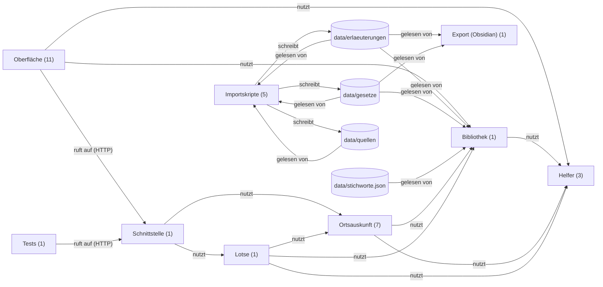
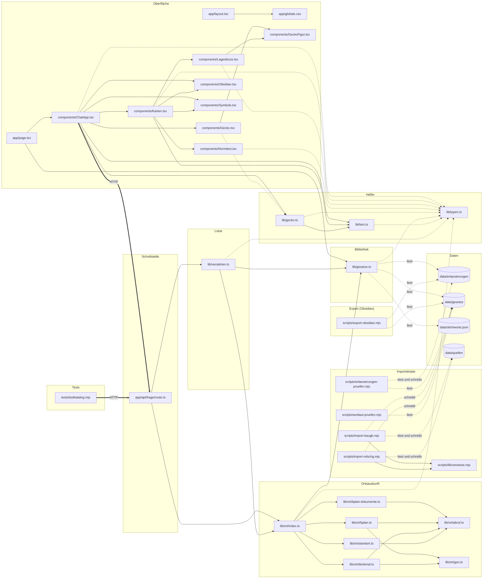

# Architektur der Bau-Normen-KI

> [!info] Automatisch erzeugt
> Diagramme und Dateilisten entstehen bei jedem Lauf von `npm run obsidian` aus den Importen im Quellcode. Nach Codeänderungen einfach neu ausführen.

## Kurz erklärt

Die App beantwortet Fragen zum Bau- und Denkmalrecht. Den Gesetzestext erfindet sie nie selbst: Er kommt immer wortwörtlich aus den amtlichen Quellen. So greifen die Teile ineinander:

1. **Importskripte** holen die Gesetze von den amtlichen Seiten (gesetze-im-internet.de, NI-VORIS) und speichern den Wortlaut unverändert als JSON in `data/gesetze/`. Sie laufen nur bei Bedarf von Hand (`npm run import:all`).  
   Dateien: [[Projekt/scripts › erlaeuterungen-pruefen.mjs.md|scripts/erlaeuterungen-pruefen.mjs]], [[Projekt/scripts › import-baugb.mjs.md|scripts/import-baugb.mjs]], [[Projekt/scripts › import-ndschg.mjs.md|scripts/import-ndschg.mjs]], [[Projekt/scripts › lib › verweise.mjs.md|scripts/lib/verweise.mjs]], [[Projekt/scripts › wortlaut-pruefen.mjs.md|scripts/wortlaut-pruefen.mjs]]
2. **Bibliothek** lädt diese JSON-Dateien und liefert Paragraphen, Verweise und Suchtreffer. Sie erzeugt keinen eigenen Gesetzestext – alles kommt 1:1 aus den Daten.  
   Dateien: [[Projekt/lib › gesetze.ts.md|lib/gesetze.ts]]
3. **Lotse** versteht die Frage (z. B. „§ 34 BauGB“ oder eine Adresse) und stellt die Antwort aus Bausteinen der Bibliothek zusammen.  
   Dateien: [[Projekt/lib › verstehen.ts.md|lib/verstehen.ts]]
4. **Ortsauskunft** (Ordner `lib/ort/`): Adresse -\> Standort -\> B-Plan (Stadt Oldenburg) + Denkmale (Denkmalatlas Niedersachsen) -\> feste, nachvollziehbare Regeln, welche Paragraphen zu beachten sind. Keine KI beteiligt.  
   Dateien: [[Projekt/lib › ort › abruf.ts.md|lib/ort/abruf.ts]], [[Projekt/lib › ort › bplan-dokumente.ts.md|lib/ort/bplan-dokumente.ts]], [[Projekt/lib › ort › bplan.ts.md|lib/ort/bplan.ts]], [[Projekt/lib › ort › denkmal.ts.md|lib/ort/denkmal.ts]], [[Projekt/lib › ort › geo.ts.md|lib/ort/geo.ts]], [[Projekt/lib › ort › index.ts.md|lib/ort/index.ts]], [[Projekt/lib › ort › standort.ts.md|lib/ort/standort.ts]]
5. **Schnittstelle** nimmt die Frage aus dem Browser per HTTP entgegen und reicht sie an den Lotsen weiter.  
   Dateien: [[Projekt/app › api › frage › route.ts.md|app/api/frage/route.ts]]
6. **Oberfläche** zeigt im Browser den Chat und die Paragraphen-Karten. Der Gesetzestext wird dort nur dargestellt, nicht verändert.  
   Dateien: [[Projekt/app › globals.css.md|app/globals.css]], [[Projekt/app › layout.tsx.md|app/layout.tsx]], [[Projekt/app › page.tsx.md|app/page.tsx]], [[Projekt/components › ChatApp.tsx.md|components/ChatApp.tsx]], [[Projekt/components › Gecko.tsx.md|components/Gecko.tsx]], [[Projekt/components › GeckoFigur.tsx.md|components/GeckoFigur.tsx]], [[Projekt/components › Karten.tsx.md|components/Karten.tsx]], [[Projekt/components › Lageskizze.tsx.md|components/Lageskizze.tsx]], [[Projekt/components › Normtext.tsx.md|components/Normtext.tsx]], [[Projekt/components › Obsidian.tsx.md|components/Obsidian.tsx]], [[Projekt/components › Symbole.tsx.md|components/Symbole.tsx]]
7. **Helfer** sind gemeinsame Bausteine im Ordner `lib/`, z. B. Datentypen und Textfunktionen, die mehrere Teile nutzen.  
   Dateien: [[Projekt/lib › gecko.ts.md|lib/gecko.ts]], [[Projekt/lib › text.ts.md|lib/text.ts]], [[Projekt/lib › typen.ts.md|lib/typen.ts]]
8. **Tests** schicken typische Fragen an die laufende App und prüfen die Antworten.  
   Dateien: [[Projekt/tests › testkatalog.mjs.md|tests/testkatalog.mjs]]
9. **Export (Obsidian)** erzeugt diesen Obsidian-Vault aus den Gesetzesdaten und dem Quellcode.  
   Dateien: [[Projekt/scripts › export-obsidian.mjs.md|scripts/export-obsidian.mjs]]

**Ablauf einer Frage:** Chat in der Oberfläche → Schnittstelle (HTTP) → Lotse erkennt, was gemeint ist → Bibliothek liefert den Wortlaut aus `data/gesetze/` → Antwort erscheint als Karte im Chat.

**Gesetze in den Daten:** [[BauGB]], [[NDSchG]]

## Zusammenspiel der Bereiche

Pfeile zeigen, wer wen nutzt (aus den Importen zusammengefasst) und wer welche Daten liest oder schreibt.

## Alle Dateien und ihre Importe

Durchgezogene Pfeile: Import · gestrichelt: nur Typen bzw. Datenzugriff · dick: Aufruf per HTTP.

## Zahlen

- 31 Quelldateien mit zusammen 5664 Zeilen
- 44 lokale Importe
- Erfasst werden die Ordner `app/`, `components/`, `lib/`, `scripts/`, `tests/` (ohne node_modules, .next, data/quellen)
